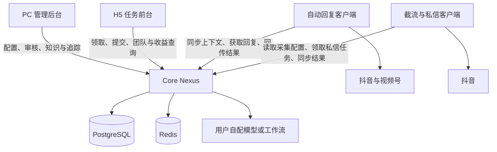

# 架构与项目分工

Core Nexus 是统一服务端。PC 提供管理界面，H5 面向任务参与者，两个桌面客户端连接平台执行操作。

## 智能客服

管理员在 PC 配置账号背景、角色、知识和规则。UCP 采集消息并同步上下文，后端处理知识、生成、回复约束与追踪，客户端再执行发送和记录。客户端代码保留发送确认、重复保护和恢复机制；实际效果与平台当前页面、账号状态和后端配置有关。

## 任务流程

PC 管理任务、分组与审核；H5 用户领取任务、提交证明并查询状态和收益；Core 维护身份、状态与账目。微信授权、短信、支付和存储等外部服务由部署者自行申请与配置。

此展示版保留当前任务分发链路。未接通的 Distribution V2 页面、数据模型及独占迁移已从本版摘出，不作为现有功能。

## 内容与线索处理

截流客户端读取机器人和目标配置，组织抖音作品及评论采集、筛选、去重与分批同步。它也包含主动私信任务的领取、执行和回报。平台入口以各项目 README 的支持表为准。

## 接口边界

普通业务主要使用 `/api/v1`，智能客服子系统另有 `/api/v5/customer-service`。UCP 的评论与私信 `runtime-reply` 入口属于 `auto-replies` 控制器；采集、设备和私信任务接口主要属于 `robots`。

后端包含微信、小程序和网站接口，这份源码目录不包含独立的小程序或官网前端。
