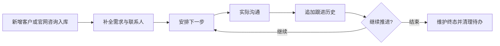

# 商机客户与跟进记录

商机客户模块用于把“有人咨询或需要继续联系”整理成可持续维护的客户记录：知道客户在做什么、需要什么、目前推进到哪一步、是否值得继续投入，以及下一次准备做什么。

PC 的“运营业务 → 商机客户”是常规入口；“官网管理 → 官网意向客户”是官网咨询的专门工作台。后端由 `customer-leads` 模块保存客户资料和逐次跟进历史。

## 1 这部分管理什么

| 内容 | 记录用途 |
| --- | --- |
| 公司和联系人 | 公司名称、联系人、职位、联系方式、地址与主营类目 |
| 线索来源 | 来源渠道及补充说明，便于回看从哪里获得线索 |
| 需求背景 | 希望解决的问题、当前方案和未成交原因 |
| 当前推进 | 所处阶段、继续跟进价值、当前跟进人 |
| 下一步安排 | 计划跟进时间和具体行动 |
| 实际历史 | 每次已经发生的沟通时间、方式、人员、结论和状态快照 |

来源、主营类目、推进状态和跟进价值分别表达不同信息。例如“官网咨询”是来源，“制造业”是客户类目，“需求调研中”是推进阶段，“产品能力待匹配”是继续跟进的判断，不能全部用一个标签代替。

## 2 当前推进与跟进价值

### 推进阶段

| 状态 | 界面含义 |
| --- | --- |
| PENDING_CONTACT | 待首次联系 |
| CONTACTED | 已建立联系 |
| REQUIREMENT_DISCOVERY | 需求调研中 |
| SOLUTION_MATCHING | 方案匹配中 |
| DEMO_OR_TRIAL | 演示或试用中 |
| BUSINESS_NEGOTIATION | 商务洽谈中 |
| ON_HOLD | 暂缓或等待条件 |
| WON | 已成交或转正式客户 |
| LOST | 已流失 |

这些是由操作员维护的业务状态，不是系统根据询盘自动证明已经成交。模块没有由一条状态记录自动生成真实销售收入的功能。

### 跟进价值

价值选项包括高优先级、持续培育、产品能力待匹配、时机未成熟、低优先级观察、暂不跟进和已转正式客户。它与阶段分开维护：客户可能已经试用，但仍需补产品能力；也可能已经建立联系，但当前时机不适合继续推进。

当前进入成交、流失、暂不跟进或已转正式客户等终态时，服务会清空下一步待办。完整枚举见 [业务常量](../../core-nexus/src/modules/customer-leads/customer-leads.constants.ts#L1)。

## 3 新增客户与登记跟进有什么区别

**新增或编辑客户**用于维护基本资料、当前阶段和接下来准备做的事。编辑客户不会把旧跟进历史改写成新内容。

**登记跟进**用于追加一次实际沟通，填写发生时间、方式、跟进人、沟通结论，以及这次沟通后的状态、价值和下一步。发生时间不早于最近一次跟进时，服务会同步当前阶段、价值和下一步；补录更早的沟通只追加历史、增加次数及按需更新首次时间，不覆盖较新的当前安排。

新增客户时也可以补录首次实际沟通。首次沟通时间和总结需要配套填写，并在创建客户的同一事务中生成第一条历史，而不是仅写一个没有沟通内容的日期。

当前跟进人是文本字段，不是自动分配任务给某个系统账号，也没有由此证明已发送提醒或建立审批流程。

## 4 一次完整使用过程

以下为虚构操作示例，不代表真实客户或成交结果。

1. 在“商机客户”新增“示例制造企业 A”，填写虚构联系资料和来源。
2. 记录“希望减少重复产品咨询”的需求，当前阶段设为需求调研中。
3. 已发生沟通时，用“登记跟进”保存日期、沟通摘要和待确认问题。
4. 将下一步写为“整理两类咨询样例，再进行演示”，设置计划时间。
5. 完成下一次沟通后再追加历史，而不是覆盖上一次总结。
6. 如果暂时缺少对方需要的能力，可以调整为产品能力待匹配，保存原因。
7. 确实结束推进时，按实际情况维护终态，不用演示状态虚构销售结果。

## 5 官网咨询怎样进入客户工作台

官网表单通过独立公开接口提交，服务端创建官网来源客户，并保留不可覆盖的原始咨询快照：公司、联系信息、业务背景、挑战、页面来源、投放参数及隐私同意时间等。

后续修改客户资料不应被理解成原咨询快照也被重写。管理员可以标记已查看、登记跟进，并在专门页面查看官网咨询统计和回收站。

官网专门列表由服务端限定为具有官网提交关联的记录，不能仅修改查询参数就把它扩展成全部商机列表。

详见 [官网内容与咨询表单](WEBSITE_CONTENT.md)。截流评论、私信任务和商机客户是不同数据对象，本仓库不能据此宣称“采集到评论就自动形成已确认的销售商机”。

## 6 删除与历史

常规客户删除为软删除。官网意向客户还提供回收站、恢复和彻底删除入口；彻底删除要求先进入回收站，并会移除关联原始咨询与跟进历史。

跟进历史采用追加方式保存，当前接口没有提供任意改写旧历史的普通编辑功能。发生新的沟通，应该再登记一次。

## 7 权限与数据范围

列表、创建、修改、登记跟进、删除及官网咨询的查看/恢复/清除等使用不同权限。仅有只读权限不应被视为可以维护全部客户资料。

**当前 CustomerLead 模型没有 tenantId，列表服务也没有按当前租户过滤。** 它是受后台权限控制的共享管理数据，不能作为已经完成客户级租户隔离的 CRM 对外介绍。若要让互不相关的组织共用实例，需要先补齐数据范围设计与验证。

源码证据：[客户模型](../../core-nexus/prisma/schema.prisma#L203)、[列表查询](../../core-nexus/src/modules/customer-leads/customer-leads.service.ts#L31)。

## 8 页面、接口与源码入口

| 内容 | 入口 |
| --- | --- |
| PC 客户列表及筛选 | [商机客户页面](../../kf-pc/src/views/customerleadmanagement/index.vue) |
| 新增与编辑字段 | [客户表单](../../kf-pc/src/views/customerleadmanagement/components/CustomerLeadFormDialog.vue) |
| 实际沟通录入 | [跟进弹窗](../../kf-pc/src/views/customerleadmanagement/components/CustomerLeadFollowUpDialog.vue) |
| 字段与状态定义 | [客户 DTO](../../core-nexus/src/modules/customer-leads/dto/customer-lead.dto.ts#L9)、[跟进 DTO](../../core-nexus/src/modules/customer-leads/dto/customer-lead-follow-up.dto.ts#L13) |
| 常规客户与历史接口 | `/api/v1/customer-leads`、`/:id/follow-ups` |
| 官网咨询专门接口 | `/api/v1/customer-leads/website-inquiries` |
| 状态与历史同步 | [服务实现](../../core-nexus/src/modules/customer-leads/customer-leads.service.ts#L167) |

## 9 使用边界

这部分提供轻量客户资料和跟进工作台，没有完整合同、报价、发票、收入确认或企业级 CRM 的全部流程。状态由维护者按事实记录，统计数量也不等于渠道归因或实际收入。

当前代码结构已核对，尚未完成真实多人协作、权限范围、官网表单与数据库的完整联调。通用验证范围见 [验证说明](../VERIFICATION.md)。

返回 [功能说明目录](README.md)。
