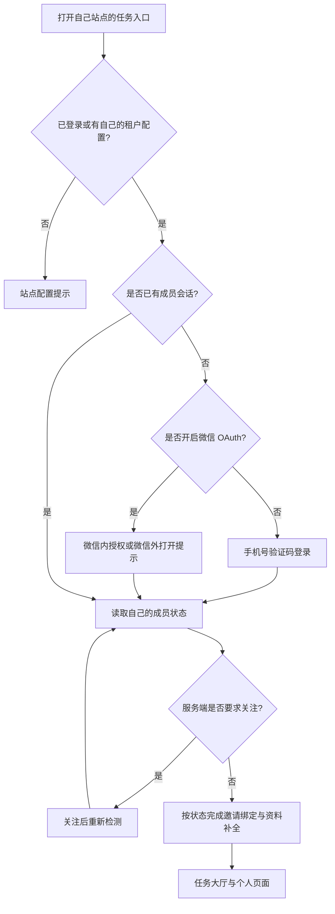

# H5 成员与团长操作指南

H5 是成员领取任务、提交证明、查看团队与收益的移动网页。本篇把首次进入、身份绑定、任务账号、记录和收款确认等支线连起来；任务金额、审核和钱包口径见[任务分发说明](TASK_DISTRIBUTION.md)。
本篇对应当前代码，不代表这些步骤已经在真实公众号、短信、付款或平台环境全部验收。账号、租户、作品和服务由使用者自行配置，使用范围遵守[非商业许可](../../LICENSE.zh-CN.md)。

## 1 先分清三个身份

| 对象 | 用途 | 不能混同为什么 |
| --- | --- | --- |
| H5 成员主体 | 登录身份、团队关系、钱包和提现归属 | 不是 PC 后台操作员 |
| 任务账号 | 同一主体下接任务使用的手机号、昵称和默认选择 | 不是另一个独立钱包，也不是平台授权登录 |
| 平台实际登录 | 用户在对应内容平台执行任务的身份 | H5 不会仅凭手机号自动登录平台或代发评论 |

一个成员可以维护多个任务账号；任务记录和截图按对应身份区分，收益及提现仍汇总到成员主体。管理员侧可以查看主体与各任务账号的关系。

## 2 首次进入会经过哪些检查

这是页面检查顺序的说明，不是所有成员每次都要重复走一遍。已有会话、已有团队或资料完整时，会跳过相应步骤；最终资格由后端判断。
路由守卫负责登录、租户配置和关注门槛；首页再按服务端返回值引导邀请绑定、资料补全。[源码：路由守卫](../../task-distribution-app/src/router/index.ts#L96)、[首页成员状态](../../task-distribution-app/src/pages/Home.vue#L630)。

## 3 出现“站点尚未配置完成”怎么办

未登录、没有配置自己的默认租户、入口也没有可用租户上下文时，会进入 `/setup-required`。
成员应联系站点管理员；“重新检查”只是重新进入首页检查条件，不会自动创建租户或发现可用账号。
部署者要先在 Core 创建自己的测试租户，再填写 `VITE_DEFAULT_TENANTS_ID`，重启开发服务或重新构建静态页面。
普通本地开发使用 `.env.development`；生产构建读取 `.env.production`。根配置脚本生成开发文件，不会自动把它当成生产配置。
旧链接显式传入的 `tenantId` 或 `tenantsId` 会保留在当前浏览器会话，避免转到登录页后丢失；它不替代后端的租户授权。
详见[H5 配置说明](../../task-distribution-app/docs/CONFIGURATION.md)与[配置提示页](../../task-distribution-app/src/pages/ConfigurationRequired.vue#L1)。

## 4 手机号登录和微信授权

### 手机号登录

默认关闭强制微信 OAuth。成员在 `/login` 填写姓名或昵称、手机号，获取短信验证码后登录；登录成功再返回原先目标页面或首页。
验证码由自己的 Core 校验。开发 mock 模式可返回测试码，真实短信不会因此在页面公开验证码；前端不会生成绕过后端的登录资格。
没有收到验证码时，先检查重发倒计时和后端短信配置，不要把反复点击视为验证码一定已经发出。

### 微信内外和回调失败

部署者开启 OAuth 后，微信内的未登录用户会转到自己的 Core 授权入口；微信外则进入 `/wechat-open-hint`。
提示页提供“复制当前链接”，用户需要把目标链接发送到微信并从微信打开；页面本身不完成微信登录。剪贴板失败时要手动复制有效业务链接。
授权返回 `/auth/wechat-callback` 后，页面检查错误和登录结果，成功时保存成员会话并返回目标路径，失败时展示原因和“重新进入”。
该回调属于授权流程，不应向成员提供手工拼接、复制或公开登录令牌的操作方法；授权失败应检查自己的应用、域名、允许回跳来源和后端设置。
源码：[手机号登录](../../task-distribution-app/src/pages/Login.vue#L1)、[微信外提示](../../task-distribution-app/src/pages/WechatOpenHint.vue#L1)、[授权回调](../../task-distribution-app/src/pages/WechatCallback.vue#L31)。

## 5 已登录却提示“请先关注服务号”

当成员状态返回未关注或要求关注时，路由会转到 `/follow-required`，拦住后续任务、团队、收益和提现页面。
用户先通过部署者提供的真实服务号入口完成关注，再回到此页点击“我已关注，重新检测”；页面请求后端刷新关注状态，满足条件后再回原目标路径。
当前页面只有提示和重新检测按钮，没有附带公众号二维码，也不能替用户自动关注。部署者要自己提供可用关注方式。
如果后端仍返回未满足条件，用户仍会被拦截；点击按钮或看到一次请求成功，不等于订阅状态一定正确。
关闭前端 OAuth 也不表示忽略服务端的关注要求。[源码：关注页与重新检测](../../task-distribution-app/src/pages/FollowRequired.vue#L34)。

## 6 成员邀请码和团长身份码

两者都使用 `/bind-invite` 页面，但模式和填写内容不同。

| 模式 | 要做什么 | 当前结果 |
| --- | --- | --- |
| 成员邀请 | 输入或从链接带入成员邀请码，核对团队预览，确认加入 | 建立服务端允许的成员团队关系 |
| 团长身份绑定 | 从团长码入口进入，填写团长码、手机号、昵称和验证码，核对后确认 | 请求绑定团长身份，仍须后端允许 |

页面会先读取代码对应的团队信息。代码不存在、团队停用、手机号冲突或关系不允许时，应按后端错误处理，不要自行替换成其他业务 ID。
已绑定成员打开普通邀请入口会返回首页；后端不支持成员任意自行换团队，应由管理员处理原关系。
当前首页对已有绑定用户的邀请参数有清理逻辑，不能承诺任意已加入团队的用户打开一个团长链接就会自动升级；升级可使用后台团长申请审核或经管理员确认的绑定流程。
团长申请与团长码绑定也不同：个人页提交“申请成为团长”后要等管理员审核，申请人不会因为提交表单立即获得团队权限。
源码：[绑定模式与提交字段](../../task-distribution-app/src/pages/BindInvite.vue#L62)、[绑定提交](../../task-distribution-app/src/pages/BindInvite.vue#L138)、[团队切换限制](../../core-nexus/src/modules/daily-tasks/daily-tasks.service.ts#L7058)。

## 7 资料补全和个人页面

首次微信授权产生的成员资料可能不完整；首页会引导到 `/profile-complete`，个人页面也提供资料维护入口。
填写姓名或昵称、手机号和短信验证码后保存，页面回任务大厅，或回首页中的个人 Tab。保存失败要看具体校验，不是跳过页面就算资料完成。
资料补全维护的是 H5 成员联系资料，不会修改为平台官方实名认证，也不会自动提供支付所需的全部微信身份。
首页 `/` 同时承载任务大厅和个人 Tab，没有单独注册一个 H5 `/profile` 页面；不要照 PC 的个人中心路径访问。
源码：[资料保存与返回位置](../../task-distribution-app/src/pages/ProfileComplete.vue#L103)、[首页资料引导](../../task-distribution-app/src/pages/Home.vue#L630)。

## 8 新增、切换和默认任务账号

在首页的任务账号选择界面查看自己可用的任务账号；新增时填写手机号、昵称并验证该手机号的短信码。
后端要求已有有效成员绑定，并将新任务账号放在对应团队下。新增失败应核对手机号占用、短信和团队关系，不是任意手机号都可直接加入。
选择另一个已有启用账号时，后端将它设为当前默认任务账号，页面刷新当前任务、可领取列表和相关记录。
切换任务账号不是切换登录成员：它不会产生第二个钱包，也不会自动完成、放弃或删除另一个任务账号的订单。
同一账号进行中的任务仍需按规则处理；不能用切换来推断后端允许同一手机号重复完成同一任务。
源码：[首页切换及新增](../../task-distribution-app/src/pages/Home.vue#L1001)、[新增验证与默认切换](../../core-nexus/src/modules/daily-tasks/daily-tasks.service.ts#L6185)。

## 9 从任务大厅到完成记录

1. 在首页确认当前任务账号和平台筛选，阅读任务要求和成员金额，再从列表或页面提供的快捷入口领取。
2. 进入 `/task-current`，按该平台步骤单独领取评论；领取任务不等于已经领取到评论。
3. 由成员在平台实际完成操作。H5 提供链接、复制和操作指引，不自动替用户发评论。
4. 按页面要求提供主页截图与本次操作证明；上传需要取得后端文件 ID，只有图片预览还不能证明业务已保存。
5. 提交成功后到 `/records` 查看状态，等待管理员审核；“完成”不等于“已结算”或“已提现”。

主页截图可在核对用户、任务账号和平台关系后复用；本次评论/点赞证明每单重新提供，界面至少一张、最多六张。
完成记录有“全部、已完成、已放弃、已驳回、已结算”标签，按当前任务账号组织。驳回单先看原因，再通过“重新提交”恢复到当前任务处理。
当前任务账号另有进行中任务时，后端会阻止同时重提。不能把重提按钮理解成直接把旧单改成审核通过。
放弃任务与驳回重提不同，当前服务按自然日限制放弃次数，管理员有独立重置入口；详细状态与金额见[任务分发说明](TASK_DISTRIBUTION.md)。
源码：[当前任务](../../task-distribution-app/src/pages/TaskCurrent.vue#L1)、[记录标签](../../task-distribution-app/src/pages/Records.vue#L130)、[重提](../../task-distribution-app/src/pages/Records.vue#L290)。

## 10 进度兼容页不是新的主任务入口

`/progress-detail` 已注册，读取本地当前作品标识，再调用旧 `/claim-comment/:id` 接口展示评论进度；部分统计也读取 URL 参数。
本轮源码检索未发现当前常规页面主动跳转到它：首页“当前任务详情”打开的是本页弹窗。因此把它列为保留的兼容页，不描述成成员主流程必点按钮。
没有相应旧作品上下文时，直接输入路由可能没有内容；该页数字也不是钱包、审核或真实支付结果。
源码：[进度兼容页](../../task-distribution-app/src/pages/ProgressDetail.vue#L106)、[当前详情弹窗入口](../../task-distribution-app/src/pages/Home.vue#L871)。

## 11 团长中心和邀请分享

已绑定且启用的团长可以从首页进入 `/leader-center`，查看自己的团队、邀请成员、完成订单、成功提现和佣金相关统计。
页面提供今日、近 7 天、近 30 天和自选日期；后端按北京时间自然日处理范围，完成订单与成功提现使用不同时间或状态口径。
复制成员邀请码、复制邀请链接、微信分享邀请是不同动作。自定义分享图、自己的公众号域名与签名服务需要部署者另外配置。
复制成功不表示对方已经加入；邀请人数、完成数、佣金和提现也不是成交或经营效果的证明。
团长自己接任务仍是成员操作；佣金是否适用及自佣限制按任务和后端规则，不因打开团长中心就自动产生收入。
源码：[团长中心](../../task-distribution-app/src/pages/LeaderCenter.vue#L20)、[时间范围](../../task-distribution-app/src/pages/LeaderCenter.vue#L195)、[分享动作](../../task-distribution-app/src/pages/LeaderCenter.vue#L275)。

## 12 申请提现和确认收款是两个动作

`/withdrawals` 显示可提现、处理中和已提现等金额。输入金额后，页面先检查金额、余额和手机微信环境，再发申请。
当前界面单次最低 0.10 元、最高 200 元；后端还有自己的限制，部署者修改限额时需要对齐两端。申请被接受不等于实际到账。
在 `/withdrawals/records` 查询每笔状态、失败/拒绝原因，并按服务端返回的操作标志处理：

| 可见操作 | 成员怎样处理 | 不能推断什么 |
| --- | --- | --- |
| 确认收款 | 在支持的微信环境发起确认，等待页面同步和查单 | 点了确认或桥接返回成功，不等于后端已经确认付款成功 |
| 模拟确认收款 | 只对后端允许的 MOCK 记录测试模拟完成 | 不发送真实付款，不可对外展示成真实到账 |
| 取消申请 | 只对允许取消的记录二次确认，等待后端处理结果 | 不是任意状态都能取消，也不是撤销已付款的通用退款 |

真实微信确认后，页面可继续同步并有限次数轮询；暂未结束时需要稍后刷新。重新打开记录页还会尝试同步最新的一笔活动微信单，并不一次保证同步所有历史单。
取消微信收款弹窗只表示本次未完成收款确认，不会自动把提现申请改成已取消；取消提现需要使用允许出现的“取消申请”动作。
成功取消、拒绝或失败等按后端规则退回冻结余额并记录流水；`PAID` 记录不能被当作任意退款入口。
后端 MOCK 申请目前仍检查服务号 `openid`，H5 发申请前仍检查手机微信；普通浏览器关闭 OAuth 后，不能据此承诺直接走完模拟提现。
后端有 MOCK 确认接口和管理端模拟/人工处理能力，仍要用合法测试身份与允许状态。[源码：记录按钮](../../task-distribution-app/src/pages/WithdrawalRecords.vue#L53)、[同步与确认](../../task-distribution-app/src/pages/WithdrawalRecords.vue#L200)、[H5 申请检查](../../task-distribution-app/src/pages/Withdrawals.vue#L219)。

## 13 管理员怎样帮助成员处理问题

在 PC“运营业务 → H5成员”区分成员主体和主体下的任务账号；钱包、累计结算及提现汇总在主体上，详情可以查看各任务账号与任务统计。

| 管理动作 | 当前用途 | 处理前要分清 |
| --- | --- | --- |
| 编辑主体、启用/禁用、删除主体 | 维护成员状态与联系资料 | 不等于删除全部历史任务、文件和流水 |
| 限制/取消限制 | 按原因和期限限制接单及发起新的提现申请 | 不等于把平台账号退出登录，也不自动撤销历史任务或已提交提现 |
| 重置放弃 | 处理当前成员的今日放弃限制 | 不是为所有成员批量取消业务规则 |
| 编辑任务账号、设默认、启停 | 管理主体下具体的任务身份 | 不创建新的成员钱包 |
| 释放任务账号占用 | 释放对应手机号的任务账号记录 | 历史任务保留快照，不删除成员主体 |

“按手机号释放占用”要先查询结果，再确认是否可释放，最后二次确认；当前绑定为团长主任务账号的手机号会被阻断，应先在团长管理处理。
这些动作与测试数据清理不同，不应概括为“一键重置用户全部资料”。管理员需要自己的后端权限，不能只因为页面显示按钮就推断任意账号可执行。
限制期的 `bannedUntil` 还会在新提现申请时校验，见 [提现限制判断](../../core-nexus/src/modules/withdrawals/withdrawals.service.ts#L601)。
PC“提现管理”另提供查询/导出、审核、拒绝、详情及微信查单同步。非微信且状态允许的记录才可人工标记已打款；该动作只更新系统状态，不调用微信付款。
证据：[H5成员详情及任务账号操作](../../kf-pc/src/views/appusermanagement/index.vue#L145)、[释放占用确认](../../kf-pc/src/views/appusermanagement/index.vue#L630)、[团长主账号阻断](../../core-nexus/src/modules/app-users/app-users.service.ts#L353)、[PC提现操作](../../kf-pc/src/views/withdrawalmanagement/index.vue#L78)。

## 14 全部注册页面与触发方式

| 路由 | 当前用途/触发 | 属于常规主线吗 |
| --- | --- | --- |
| `/` | 任务大厅与个人 Tab | 是，主入口 |
| `/login` | OAuth 关闭时的手机号登录 | 条件主线 |
| `/setup-required` | 未登录且缺少可用租户上下文 | 部署配置支线 |
| `/wechat-open-hint` | OAuth 开启但在微信外访问 | 授权支线 |
| `/auth/wechat-callback` | 后端 OAuth 返回 | 授权回调，不是手工填写令牌页 |
| `/follow-required` | 成员状态要求先关注服务号 | 关注支线 |
| `/bind-invite` | 成员邀请或团长身份码绑定 | 按关系状态进入 |
| `/profile-complete` | 资料不完整或个人页维护 | 资料支线 |
| `/task-current` | 当前任务的领取评论、证明与提交 | 是 |
| `/records` | 当前任务账号的完成、驳回、结算、放弃记录 | 是 |
| `/progress-detail` | 旧作品评论进度，依赖本地旧上下文 | 保留兼容页，未找到当前常规跳转 |
| `/leader-center` | 团队统计、邀请与分享 | 团长支线 |
| `/withdrawals` | 收益与申请提现 | 资金支线，受微信等前提限制 |
| `/withdrawals/records` | 状态、收款确认、模拟确认及允许取消 | 资金支线 |

这些是 H5 当前实际注册页；“高级管理”等旧 PC 路由不属于 H5。H5 主流程没有自动跳转到一个独立的 V2 任务系统，任务分发 V2 已摘出。
完整路由见 [router/index.ts](../../task-distribution-app/src/router/index.ts#L14)，业务 API 见 [home.ts](../../task-distribution-app/src/api/modules/home.ts#L47)。

## 15 排查时按哪一层检查

先确定是站点租户、登录授权、关注状态、团队关系、任务账号、任务资格、上传证明还是付款状态。不要把不同门槛都归为“登录失效”。
截图过期时检查文件归属和重新签发，不复用别人的截图或公开真实签名链接；任务账号切换后也要确认当前展示的证明属于正确身份。
部署配置从[统一配置说明](../CONFIGURATION.md)和[H5 配置](../../task-distribution-app/docs/CONFIGURATION.md)开始；任务状态、审核和账务见[任务分发](TASK_DISTRIBUTION.md)。
本文经过路由与相关分支的源码核对，没有新增真实平台、短信、支付或完整业务闭环的运行验收；适用范围见[验证说明](../VERIFICATION.md)。
