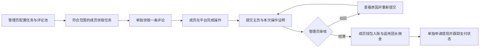

# 任务分发与成员结算

任务分发把“管理员准备任务与评论—成员领取并实际操作—提交证明—审核入账—申请提现”连接起来。PC 是管理入口，H5 是成员和团长入口，Core Nexus 保存规则、订单、文件关系和账目。
本说明对应当前保留的旧任务链路，帮助读者理解和自行配置；使用范围遵守仓库的[非商业许可说明](../../LICENSE.zh-CN.md)。这里的业务能力不代表真实支付、平台操作或完整部署已经验收。

## 1 解决什么问题

成员登录、关注检测、邀请码/团长码、资料补全、任务账号切换，以及后台接单/新提现限制、释放手机号占用等完整步骤，见 [H5 成员与管理员操作指南](H5_MEMBER_GUIDE.md)。本篇侧重任务、审核、金额和结算链路。

管理员可以把一个平台作品对应的执行要求、可领取评论、目标数量、成员金额和团队范围集中管理，避免只靠聊天消息分配任务、收截图和核对账目。
成员通过 H5 查看自己可领取的任务、获得一条评论、返回提交证明，再查询审核结果与收益；团长通过邀请关系组织团队并查看相应统计。
系统记录的是任务组织与提交过程。提交截图、点击完成或出现收益数字，都不能证明平台实际分发效果、内容质量、获客结果或银行资金已经到账。

## 2 谁使用，各负责什么

| 角色 | 主要操作 | 责任边界 |
| --- | --- | --- |
| 平台/租户管理员 | 创建后台账号、租户、媒体账号、权限和团队 | 后端校验可管理范围，前端菜单隐藏不能代替鉴权 |
| 运营人员 | 新建任务、维护评论池、发布/暂停、查看进度 | 需要对应 `daily-task:*` 权限 |
| 审核结算人员 | 查看成员证明、驳回或填写实际结算金额 | 审核结算是钱包入账流程，和提现付款分开 |
| H5 成员 | 登录、绑定邀请、选择任务账号、领取和提交 | 只能处理服务端允许的任务与自己的记录 |
| 团长 | 绑定团长身份、邀请成员、查看团队和佣金 | 团长身份须经绑定或后台审核，不由申请人自行取得 |
| 部署者 | 配置后端、文件、短信、前端租户与可选微信支付 | 仓库不附带可直接使用的服务账户或原业务数据 |

当前管理导航见 [PC 菜单](../../kf-pc/src/router/menu.ts#L15)，H5 页面见 [H5 路由](../../task-distribution-app/src/router/index.ts#L14)。

## 3 一条任务如何走完

领取任务与领取评论是两个接口动作。前者建立当前任务记录，后者才占用一条评论；这让成员返回页面时可以恢复正在进行的步骤。
整个流程不要求 PC 直接控制 H5，也不由自动回复机器人替成员完成平台操作；机器人是另一条业务链路。

## 4 任务配置和评论池

在 PC“运营业务 → 每日任务”创建任务，选择租户、已启用的媒体账号、平台、作品链接、标题和执行要求。
多个作品访问链接会保存主链接与排序；封面、说明、评论要求和备注用于让成员理解本次任务。

| 配置 | 业务含义 | 使用时注意 |
| --- | --- | --- |
| 目标评论数 | 当前任务希望完成的评论数量 | 发布接口要求评论池数量不少于目标 |
| 评论池 | 可被成员领取的逐条评论记录 | 文案由部署者准备，不能把样例当成真实用户意见 |
| 任务金额 | 计算每单成员金额与佣金的基础值 | PC 此字段以整数“分”录入，不是整个活动的累计预算 |
| 投放范围 | 全租户开放或指定团队 | 指定团队须属于当前租户且可用 |
| 团长分佣 | 指定团队任务可配置比例或固定金额 | 规则在当前任务维护，不再依赖团长档案中的旧默认规则 |
| 测试标记/批次 | 供受控的测试数据管理与清理使用 | 不替代独立开发库或完整的测试用户隔离 |

评论可在管理界面新增、编辑、批量导入和导出；也存在请求后端生成评论的入口，使用模型时需配置自己的服务并审核输出。
当前评论 Excel 模板由浏览器生成空白工作簿，表头包含类型、评论内容、配套回复序号、配套回复和发布建议，没有附带原业务文案。
模板中的配套字段不等于后台会自动替平台发送回复；实际任务池保存的核心内容仍是可领取的评论文本。
已被领取的评论涉及参与记录，调整评论池前应检查领取与完成状态，不能按删除普通草稿的方式处理所有历史记录。
配置界面与佣金预览见 [任务表单](../../kf-pc/src/views/dailytaskmanagement/components/DailyTaskFormDialog.vue#L25)，模板实现见 [commentTemplate.ts](../../kf-pc/src/views/dailytaskmanagement/commentTemplate.ts#L53)。

## 5 分组、派发和团长团队

“全租户开放”面向该租户内满足条件的成员，不支持在该任务中启用团长分佣；“指定团队”则选择一个具体团队。
团长管理包含团队档案、团长申请审核和佣金明细三个页面标签。管理员可创建团队、绑定团长、启用/停用、管理成员邀请码和团长身份码。
成员邀请码用于加入团队，团长身份码用于绑定团长角色，两者不能混用。H5 团长申请只提交申请资料，后台审核通过后才建立或切换团队身份。
团长本人也能领取任务；代码默认不为团长自己完成本团队任务产生自佣，除非后端相关配置显式允许。
普通解绑会检查进行中订单、待结算等阻断项，保留历史归属；测试重置和强制解绑删除是另一组受控能力，不应当成日常团队删除按钮使用。

点击“发布”时，后端检查评论数量和媒体账号，写入派发记录并更新任务；PC 可以复制任务链接与派发文案，供运营人员再分发。
配置了服务号通知时，后端还尝试发送任务通知；通知失败会记录失败原因，不表示任务发布事务自动撤销。
派发文案属于可调整的产品模板，其中的平台操作说法不是平台机制的验证结论，使用者应核对自己的真实任务要求。
后端还保留团队协作授权接口和范围判断，但当前 PC 团长页面没有独立协作配置面板，不应宣传成现成的跨团队配置工作台。
代码入口：[发布与状态操作](../../core-nexus/src/modules/daily-tasks/daily-tasks.service.ts#L1424)、[团长页面](../../kf-pc/src/views/distributiongroupmanagement/index.vue#L65)、[分发控制器](../../core-nexus/src/modules/daily-tasks/daily-tasks-distribution.controller.ts#L258)。

## 6 成员领取、操作和提交证明

成员先完成手机号登录或自行配置的微信授权，补齐资料并建立有效团队关系，再使用当前任务账号查看任务。
一个登录成员可以有任务账号列表；当前任务账号的手机号和昵称用于订单身份与重复领取判断，不等同于平台官方账号授权。
服务端按租户、团队、可用评论、用户限制和任务状态筛选列表；当前任务账号已有进行中任务时，不能直接再领另一单。
同一任务账号手机号已经完成该任务时，后端拒绝重复领取。切换账号并不意味着可以跳过服务端身份和范围检查。
领取后按步骤取得评论、复制内容、打开对应平台，由成员实际执行；H5 只提供引导，不提供平台官方自动评论接口。

当前提交流程区分两组图片：主页截图用于核对任务账号；评论/点赞截图用于本次任务，至少一张，界面最多接收六张。
主页截图可按用户、任务账号和平台关系复用，访问时需后端校验并重新签发地址；本次操作截图要求重新上传。
上传完成要保留后端返回的文件 ID，页面出现图片预览不等于文件已成功绑定订单。提交成功后，参与记录和对应评论才转为完成。
配置了主页 OCR 时，识别在后端异步进行，结果只供运营核验，不自动覆盖成员手填昵称或手机号，也不替代人工确认。
证明组件见 [TaskProofUploadGroups.vue](../../task-distribution-app/src/components/TaskProofUploadGroups.vue#L3)，提交校验见 [TaskSteps.vue](../../task-distribution-app/src/components/TaskSteps.vue#L1272)。

## 7 审核、驳回和结算

PC 在每日任务中打开订单，按参与状态、结算状态、姓名/手机号或是否有证明筛选，查看主页及本次操作图片。
“完成”表示成员已提交，并不是管理员已经认可。管理员核对后，可以填写结算金额、可选付款订单号和备注，再确认结算。
结算接口只接受已完成订单；有 H5 用户关联时，首次结算按实际提交的金额增加成员钱包，并记录流水。适用的团长佣金单独入账。
付款订单号和备注只是管理记录；仅填写这些字段不会自动发起外部付款。该结算接口仍会给关联钱包入账，若另有系统外付款，需要自行核对，不能以为填了外部单号就会自动冲减钱包。

驳回必须说明原因，已结算订单不能直接驳回。当前实现把参与记录恢复为已领取、结算状态标为驳回，清掉本次提交证明引用，并保留其评论归属等待重提。
成员从任务记录发起重新提交；若当前任务账号另有进行中任务，服务端会阻止同时重提。补齐新证明并再次提交后，回到待审核状态。
放弃进行中任务是另一动作，会释放已领取评论并写放弃日志；当前后端按自然日限制每天最多两次，不是任意次数重领。
审核逻辑见 [settleOrder](../../core-nexus/src/modules/daily-tasks/daily-tasks.service.ts#L1989)、[rejectOrder](../../core-nexus/src/modules/daily-tasks/daily-tasks.service.ts#L2124)、[放弃任务](../../core-nexus/src/modules/daily-tasks/daily-tasks.service.ts#L3598)。

## 8 状态必须分开看

同一任务有任务状态、评论状态、成员参与状态和结算状态，不能用一个“完成”标签概括全部。

| 层次 | 主要值 | 当前含义 |
| --- | --- | --- |
| 任务 | `DRAFT` / `READY` | 草稿或评论池数量达到准备条件 |
| 任务 | `DISPATCHED` / `RUNNING` | 已派发或已有领取/执行进度 |
| 任务 | `COMPLETED` | 完成评论数量达到目标，不表示所有钱包结算或提现结束 |
| 任务 | `PAUSED` / `CLOSED` | 暂停或关闭新领取；控制器设计仍允许历史已领取单完成和结算 |
| 任务 | `ARCHIVED` | 从默认列表归档，历史记录仍需保留查询 |
| 评论 | `AVAILABLE` → `CLAIMED` → `COMPLETED` | 可领取、已占用、已提交完成 |
| 参与记录 | `STARTED` → `CLAIMED` → `COMPLETED` | 先领任务，再领评论，再交证明 |
| 参与记录 | `ABANDONED` | 放弃当前单，不属于正常完成 |
| 结算 | `UNSETTLED` / `REJECTED` / `SETTLED` | 未结算、审核驳回、已确认钱包结算 |

特别注意：当前 H5 列表查询接受 `READY`、`DISPATCHED` 和 `RUNNING`。保存/修改评论后会重算任务状态，评论充足可能成为 `READY`；因此“没有点发布就绝不可能被领取”不是当前代码保证。
任务计数也会重算状态，不能只照一张理想状态图推断暂停/关闭与历史单操作的所有组合；部署前应验证这些组合的实际结果。
实现见 [列表范围](../../core-nexus/src/modules/daily-tasks/daily-tasks.service.ts#L3150) 与 [计数重算](../../core-nexus/src/modules/daily-tasks/daily-tasks.service.ts#L4190)。

## 9 金额、佣金和钱包口径

数据库和接口金额主要使用整数分；部分页面按元显示或输入，再转成分。不要把 `100` 一概当作 100 元。

| 字段/显示项 | 口径 |
| --- | --- |
| `taskBudgetAmount` | 管理端录入的每单基础任务金额，按它计算佣金 |
| `rewardAmount` | 成员端可见的配置金额；包含分佣时已扣除团长佣金 |
| `commissionAmount` | 该单团长佣金的配置快照 |
| `settlementAmount` | 审核人员实际确认的成员结算金额，钱包入账以此为准 |
| `balanceAmount` / 可提现余额 | 当前可用于新提现申请的余额，不含已经申请后冻结的部分 |
| 待提现金额 | 处理中提现记录的金额汇总，不能再和可提现余额相加当作新增收益 |
| 已提现金额 | 后端记为 `PAID` 的汇总；真实支付模式仍需支付服务确认 |

比例分佣用基点保存：`100` 表示 1%，`1000` 表示 10%；固定分佣的值用分保存。比例结果向下取整数分。
`INCLUDED`：成员配置金额＝基础任务金额−佣金，配置的每单总成本＝基础任务金额。
`EXTRA`：成员配置金额＝基础任务金额，配置的每单总成本＝基础任务金额＋佣金。
**纯计算示例**：基础金额 100 分、比例 10%，佣金 10 分；包含式成员 90 分、合计 100 分，额外式成员 100 分、合计 110 分。这不是平台定价或经营收益。
这些是每单配置值，不是整个目标数量的总预算；多单累计还要按实际完成、实际结算、适用佣金和退款流水核对。
已有用户领取后，范围、金额、团队和佣金快照受到锁定；历史订单复制领取时快照，不因后来改团长资料自动重算。
实际结算金额可由审核人员录入，可能与任务预览不同；不要用预览总额代替最终流水对账。
规则实现见 [佣金计算](../../core-nexus/src/modules/daily-tasks/daily-tasks.service.ts#L6935) 和 [钱包入账](../../core-nexus/src/modules/daily-tasks/daily-tasks.service.ts#L2035)。

## 10 提现与真实支付、模拟支付

提现和任务结算是独立流程：申请提现先从可用余额扣减形成冻结记录；成功后累计已提现，失败/驳回/取消等按服务端流程退回余额并记流水。
同一用户有一笔处理中提现时，当前服务拒绝继续申请另一笔；这和是否还有余额是两个检查。

| 提现状态 | 含义 |
| --- | --- |
| `PENDING` | 待审核，不是已经付款 |
| `APPROVED` | 已批准，后续步骤取决于转账模式 |
| `WAIT_USER_CONFIRM` | 等待收款确认，仍不能显示为实际到账 |
| `PROCESSING` | 转账处理中，应查单或等待回调 |
| `PAID` | 服务端确认完成；MOCK 模式仅表示模拟完成 |
| `REJECTED` / `FAILED` / `CANCELLED` / `EXPIRED` | 驳回、失败、取消或过期，应结合退款流水和原因核对 |

后端模式包含 `WECHAT`、`MANUAL`、`MOCK`。真实微信模式需要自己的商户、服务号身份、密钥证书和回调配置，以回调/查单为准，管理端不能随意人工标记真实微信单已付款。
MOCK 不发送真实付款，但当前后端申请仍检查服务号 `openid`；当前 H5 发申请前也检查手机微信运行环境。因此关闭 OAuth 后的普通浏览器并不是完整模拟提现演示通道。
后端虽有 `mock-confirm` 接口，仍要有合法测试身份和合适状态。可测试后端模拟账务，不应伪造服务号身份或把模拟结果展示成真实打款。
H5 还硬编码单次最低 10 分、最高 20000 分；后端有自己的金额配置。修改部署限额时需对齐两端，不能只改一个环境变量。
详见 [提现申请](../../core-nexus/src/modules/withdrawals/withdrawals.service.ts#L42)、[冻结](../../core-nexus/src/modules/withdrawals/withdrawals.service.ts#L324)、[退款与成功确认](../../core-nexus/src/modules/withdrawals/withdrawals.service.ts#L414)、[H5 微信环境检查](../../task-distribution-app/src/pages/Withdrawals.vue#L219)。

## 11 从零配置的顺序

1. 按[本地启动指南](../QUICK_START.md)准备独立 PostgreSQL、Redis、Core 和自建管理员，先确认后台能登录。
2. 建立测试租户、媒体账号和必要权限，再创建团队或准备团长申请审核；不要把原系统账号当作演示账号。
3. 从[统一配置](../CONFIGURATION.md)填写本地 PC/H5 地址与 H5 自己的租户标识。H5 未配置租户且未登录时显示站点配置提示。
4. PC 本地常用端口为 5173，H5 `pnpm dev` 指定 5174；以实际启动端口为准，PC 派发链接须指向自己的 H5。
5. 先保留 OAuth 关闭，用自己的后端 mock 短信或测试短信完成成员登录；MOCK 只用于开发，不把验证码示例作为公开服务安全配置。
6. 确认本地文件上传与读取可用；若需要私有 COS、缩略图或 OCR，再分别配置自己的服务并验证文件权限。
7. 运行一条不涉及真实付款的任务闭环，确认成员提交、驳回、重新提交、实际结算金额和钱包流水一致。
8. 最后单独验收微信授权、分享、通知和支付。根脚本生成的是前端 `.env.development`；生产构建要另建 `.env.production`，并按 H5 配置设生产环境值。

具体变量见 [PC 配置](../../kf-pc/docs/CONFIGURATION.md) 与 [H5 配置](../../task-distribution-app/docs/CONFIGURATION.md)。

## 12 管理员与成员操作示例

以下是**虚构的本地测试示例**，不对应真实客户、作品、成员身份或获客结果；作品链接应使用测试者有权操作的内容。
管理员先建立“示例测试团队”和测试成员，确认成员通过邀请码绑定，再创建一条目标数量为 2 的任务，准备两条经审核的测试评论。
在任务中选择该团队，先关闭分佣，填写每单 100 分；核对成员可见金额后保存。保存后的 `READY` 可见性按前述实际规则验证，不拿草稿标签当隔离措施。
管理员打开评论池确认两条记录可领取，点击发布并复制自己的 H5 任务入口，交给测试成员；派发记录成功与服务号通知成功分别检查。
成员用测试手机号登录，确认当前任务账号，查看任务要求后领取；进入当前任务，再领取一条评论，按页面步骤执行自己的测试内容。
成员上传可识别的主页截图和本次操作证明并提交，回到任务记录查看；这时检查的是待审核记录，不应立即期待资金到账。
管理员在订单中先用一单验证“驳回并说明原因”；成员从记录重提并更换本次证明，再由管理员确认 100 分结算。
另一名测试成员完成第二条任务，管理员核对任务完成数、各参与记录、已结算金额与钱包流水，不把任务达到目标等同于两人都已结算。
基础闭环通过后，可以另建一条指定团队分佣测试任务，验证成员与团长的独立入账；不要修改已有领取任务去重算历史佣金。
提现作为单独测试项，在满足前述身份与运行环境条件后验证；只检查 MOCK 状态时，明确标注模拟，不填写“真实到账”。

## 13 常见异常与当前边界

| 现象 | 先检查什么 |
| --- | --- |
| H5 显示站点未配置 | 自己的租户配置是否填写、当前构建是否读取对应环境文件 |
| 登录成功却没有任务 | 当前团队/任务账号、租户、任务状态、可用评论、账号限制和是否已完成过该任务 |
| 不能领取另一单 | 当前任务账号是否仍有进行中单；先完成、按规则放弃或处理驳回重提 |
| 发布失败 | 评论池是否达到目标、媒体账号是否启用、是否有发布权限 |
| 提交按钮不通过 | 是否真正取得文件 ID、主页截图和本次操作证明是否齐全 |
| 图片过期或打不开 | 后端访问签发、文件绑定与权限、公开文件根地址，不用旧签名链接作永久链接 |
| 金额与预期不同 | 分/元、包含/额外分佣、实际结算金额、已冻结提现、团长自佣条件 |
| 普通浏览器不能提现 | 这是当前手机微信限制，不是配置 MOCK 就会取消的前端条件 |
| 以为已有跨团队/V2工作台 | 当前 V2 已摘出；旧协作接口存在不代表当前界面全部接通 |

平台操作截图已替换为明确标注的通用示意，使用者需自行制作适合自己环境的有效指引。任务数据和证明可能含个人资料，不应拿真实记录做公共截图或示例种子。
当前说明基于源码与已完成的离线构建范围，没有新增真实平台、短信、支付或全流程业务验收；重复结算、并发领取、断网恢复与状态交互应在自建环境专门验证。

## 14 数据记录与源码阅读入口

| 记录 | 保存内容与用途 |
| --- | --- |
| `DailyTask` / `DailyTaskVideoLink` | 任务范围、作品链接、目标、配置金额与状态 |
| `TaskComment` / `TaskDispatch` | 评论可用/占用/完成，以及派发/通知结果 |
| `TaskParticipant` | 领取身份、任务账号、证明引用、驳回、实际结算及佣金快照 |
| `DistributionGroup` / `DistributionUserBinding` | 团队、团长、邀请码和成员归属 |
| `DistributionTaskAccount` / `DistributionLeaderApplication` | 任务账号和团长申请审核 |
| `LeaderCommissionSettlement` / `AppUserWalletLedger` | 团长独立佣金、成员入账、提现扣减与退款流水 |
| `AppUserWithdrawal` / 文件及使用关系 | 提现模式、支付状态、原因，以及图片属于哪张订单 |

PC 的日常入口是 `/daily-tasks`、`/distribution-groups`、`/app-users`、`/withdrawals`、`/media-accounts`；订单在每日任务内打开。
H5 的日常入口是 `/`、`/task-current`、`/records`、`/leader-center`、`/withdrawals`、`/withdrawals/records`，登录和邀请绑定按路由引导完成。

| 接口入口，前缀均为 `/api/v1` | 用途 |
| --- | --- |
| `GET /daily-tasks`、`POST /daily-tasks`、`GET/PATCH /daily-tasks/:id` | 管理列表、创建、详情和编辑 |
| `POST /daily-tasks/:id/dispatch`、`pause`、`resume`、`close`、`archive` | 任务操作 |
| `/daily-tasks/:id/comments`、`progress`、`orders` | 评论池、执行进度、订单审核入口 |
| `POST /daily-tasks/:id/orders/:participantId/settle` 或 `reject` | 实际结算或驳回 |
| `/distribution-groups` | 团队、邀请、团长申请、佣金明细 |
| `/app/distribution/tasks`、`tasks/claim`、`tasks/current/claim-comment`、`tasks/current/complete` | 成员查看、领取、取评论与提交 |
| `/app/distribution/orders`、`tasks/:participantId/resubmit`、`tasks/abandon-current` | 成员记录、重提、放弃 |
| `/app/distribution/withdrawals` 与 `/withdrawals` | 成员提现与后台审核；两者身份和权限不同 |

推荐阅读顺序：[PC 任务页面](../../kf-pc/src/views/dailytaskmanagement/index.vue#L166) → [H5 API 清单](../../task-distribution-app/src/api/modules/home.ts#L47) → [任务控制器](../../core-nexus/src/modules/daily-tasks/daily-tasks.controller.ts#L141) → [成员控制器](../../core-nexus/src/modules/daily-tasks/daily-tasks-distribution.controller.ts#L140) → [服务端领取逻辑](../../core-nexus/src/modules/daily-tasks/daily-tasks.service.ts#L3193) → [提现服务](../../core-nexus/src/modules/withdrawals/withdrawals.service.ts#L42) → [数据模型](../../core-nexus/prisma/schema.prisma#L578)。
