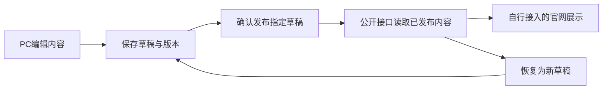

# 官网内容与咨询表单

官网管理由两部分组成：一是管理准备公开展示的内容配置，二是接收访客提交的业务咨询并转入客户跟进工作台。PC 提供编辑界面，Core 提供草稿、发布和咨询接口。

**本仓库没有独立官网前端。** 如要展示实际公开网站，使用者需自行实现或接入读取这些配置与提交表单的页面，不能只启动 PC 后台就期待出现完整官网。

## 1 内容管理解决什么问题

后台编辑与访客看到的内容分开。编辑者可以先调整文案、模块和素材，保存草稿，确认后再发布；保存未完成内容不会直接覆盖已发布配置。

当前属于固定布局的内容配置，不是任意拖拽生成页面的通用建站器。允许的内容结构由校验器控制，原业务客户名单、素材路径和效果承诺已从初始内容中清理。

## 2 草稿、发布、恢复的区别

| 操作 | 改变什么 | 不应怎样理解 |
| --- | --- | --- |
| 读取管理配置 | 同时取得草稿、已发布内容及各自版本信息 | 不代表这些内容都已对公众开放 |
| 保存草稿 | 更新草稿并增加草稿版本 | 不会立即改变公开读取结果 |
| 发布草稿 | 将指定草稿快照写入已发布内容，记录发布人和时间 | 不是自动部署一个官网应用 |
| 恢复已发布内容为草稿 | 将当前发布内容复制回新草稿 | 不是任意历史版本回滚，也不会直接改已发布内容 |
| 公开读取配置 | 返回当前已发布内容；没有时 configured=false | 不返回未发布草稿 |

保存、发布和恢复会检查对应的版本号。其他人已经改过草稿时，操作可能要求重新加载，避免无提示覆盖更新。

源码入口：[配置模型](../../core-nexus/prisma/schema.prisma#L258)、[草稿与发布服务](../../core-nexus/src/modules/website/website.service.ts#L50)。

## 3 图片素材

官网图片有单独上传入口，需要官网素材上传权限。服务检查实际图片签名，当前接受 JPEG、PNG、WebP 或 ICO，大小限制为 5MB；它不是任意文件托管入口。

素材上传后会建立官网业务绑定，页面再引用回显地址。部署者需要提供自己有权使用的图片，并保证文件服务、资源地址和实际官网访问环境一致。

这些限制来自 [官网控制器](../../core-nexus/src/modules/website/website.controller.ts#L99)，不应套用为所有业务上传的统一规则。

## 4 咨询表单收集什么

公开表单输入公司或品牌名称、联系人、联系方式、业务和目标客户概况、当前运营账号及主要挑战。提交时必须明确同意按相应隐私政策处理联系信息。

请求还可以携带当前页面、来源页面、UTM 参数及表单开始时间；每次提交需要 UUID `requestId`，用于识别重复点击和网络重试。

这些来源字段保存的是提交时携带的信息，不会单独证明某个渠道带来真实成交，也不是完整的营销归因系统。

表单不能自行指定后台负责人、成交状态或任意内部业务字段，后端会固定创建官网来源的待联系客户，并记录原始提交快照。

源码入口：[表单字段](../../core-nexus/src/modules/website/dto/website.dto.ts#L42)、[表单入库逻辑](../../core-nexus/src/modules/website/website.service.ts#L100)。

## 5 提交保护与返回结果

- 相同 `requestId` 重试时可以返回已有提交引用，避免正常重试重复创建客户。
- 服务对 IP 和联系信息分别做哈希及频率限制，计数依赖 Redis。
- 表单包含蜜罐字段和过快提交检查；命中时可能返回接受结果，但不创建客户。
- 正常入库在事务中同时创建客户记录和原始提交，避免两部分只成功一半。

因此，前端拿到 `accepted=true` 不能直接用来计算“新增有效客户”，应结合管理端实际记录。哈希 IP 和限流用的联系哈希也不代表联系信息全文没有保存，原始咨询快照仍包含用户提交的内容。

## 6 管理员如何处理咨询

1. 在“官网意向客户”查看新提交和未读数量。
2. 打开详情，核对原始问题与联系方式，标记已查看。
3. 如果真实发生联系，登记跟进，记录结论、阶段及下一步。
4. 持续跟进时维护客户资料，但不把原始咨询快照改写成新的历史。
5. 不需要保留的记录先进入回收站；恢复与彻底删除使用不同权限。

更完整的客户状态、历史和终态说明见 [商机客户与跟进记录](CUSTOMER_LEADS.md)。

## 7 自行接入需要准备

| 准备项 | 要完成的事 |
| --- | --- |
| 公开页面 | 自行提供官网前端，读取发布配置并展示未配置时的兜底内容 |
| 表单 | 按 DTO 提交字段、生成 requestId、展示隐私信息并取得同意 |
| 后端 | 配置站点来源、Redis、上传和限频参数 |
| PC 权限 | 给内容编辑、发布、素材上传、咨询查看和跟进分别授权 |
| 素材与文案 | 填写真实可证明的介绍，替换全部演示或空白内容 |

例如学习环境可以创建“示例站点 A”，先保存一段测试介绍，确认公开配置仍未变化，再发布并查看公开接口结果。测试咨询全部使用虚构信息，验证后台能查看和登记一次跟进。此例只描述操作顺序，不代表已经验证公网网站可用。

## 8 页面与接口

| 内容 | 入口 |
| --- | --- |
| PC 官网内容编辑 | [官网内容页](../../kf-pc/src/views/websitemanagement/index.vue) |
| PC 官网咨询处理 | [官网意向客户页](../../kf-pc/src/views/websiteinquirymanagement/index.vue) |
| 公开读取发布配置 | `GET /api/v1/public/website/config` |
| 公开提交咨询 | `POST /api/v1/public/website/inquiries` |
| 后台草稿、发布、恢复 | `/api/v1/website-management/configuration` 下对应接口 |
| 后台上传图片 | `POST /api/v1/website-management/assets` |
| 内容结构校验 | [内容校验器](../../core-nexus/src/modules/website/website-content.validator.ts) |
| 控制器与权限 | [官网接口](../../core-nexus/src/modules/website/website.controller.ts#L34) |

## 9 当前范围与限制

官网配置使用固定 ID 的全局记录，没有每租户一套独立官网配置；相关咨询客户也没有完整租户隔离。若要做多客户建站平台，需要额外设计站点、租户与数据范围。

当前不包含官网前端托管、域名注册、任意页面搭建、全历史版本库或自动销售转化能力。真实公开网站、表单、限流和管理端的端到端运行仍需在使用者环境验收。

返回 [功能说明目录](README.md)。
